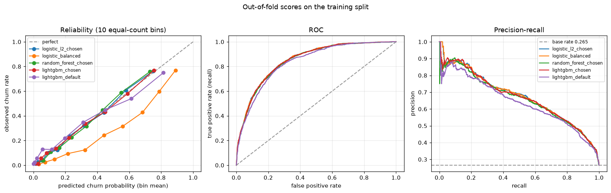

# Ranking and calibration

All scores are out-of-fold on the training split (5,634 customers, churn rate 26.5%): every customer is scored by a model that never saw them, on the same 5 folds as the other reports. Recalibration is also fitted out-of-fold, so recalibrated numbers are not graded on rows the calibrator saw. The test split has not been used.

## 1. Ranking: ROC against precision-recall

`precision at 50% recall` is the best precision among cutoffs that still catch half the churners; `recall at 5% FPR` is the share of churners caught while wrongly flagging at most 5% of loyal customers.

| model | ROC-AUC | PR-AUC | precision at 50% recall | precision at 80% recall | recall at 5% FPR | recall at 10% FPR |
|---|---|---|---|---|---|---|
| `logistic_l2_chosen` | 0.850 | 0.672 | 0.689 | 0.528 | 0.367 | 0.554 |
| `logistic_balanced` | 0.850 | 0.672 | 0.692 | 0.526 | 0.364 | 0.547 |
| `random_forest_chosen` | 0.847 | 0.662 | 0.675 | 0.521 | 0.355 | 0.541 |
| `lightgbm_chosen` | 0.849 | 0.668 | 0.681 | 0.528 | 0.349 | 0.541 |
| `lightgbm_default` | 0.835 | 0.640 | 0.642 | 0.512 | 0.346 | 0.495 |

- ROC-AUC separates these models over a range of 0.015; PR-AUC over 0.033, about 2.2 times as wide. With only 26.5% churners, a large number of loyal customers dilutes precision, which ROC (built from rates within each class) does not show. A no-skill model scores 0.500 on ROC-AUC but only 0.265 on PR-AUC, so PR-AUC is the more informative scale here.
- Read operationally, `logistic_l2_chosen` catches 55% of churners at a 10% false-alarm rate, and to catch 80% of churners about 47% of the flagged customers would be loyal ones.
- `logistic_balanced` has the same ROC-AUC and PR-AUC as `logistic_l2_chosen` (0.850 and 0.672): class weights change the scores, not the order of customers. The next section shows what they do cost.

## 2. Calibration: do the probabilities mean what they say?

`slope` and `intercept` come from regressing the outcome on the log-odds of the score: perfect is slope 1, intercept 0; slope below 1 means overconfident scores, a negative intercept means scores that are too high. `mean score` should equal the churn rate.

| model | Brier | log loss | ECE | slope | intercept | mean score |
|---|---|---|---|---|---|---|
| `logistic_l2_chosen` | 0.133 | 0.411 | 0.013 | 1.06 | +0.03 | 0.265 |
| `logistic_balanced` | 0.161 | 0.483 | 0.149 | 1.05 | -1.02 | 0.414 |
| `random_forest_chosen` | 0.135 | 0.415 | 0.017 | 1.10 | +0.06 | 0.265 |
| `lightgbm_chosen` | 0.133 | 0.412 | 0.010 | 1.02 | +0.01 | 0.266 |
| `lightgbm_default` | 0.140 | 0.436 | 0.034 | 0.74 | -0.11 | 0.259 |

Reliability of `logistic_l2_chosen` and of `logistic_balanced`, in ten equal-count groups from lowest to highest predicted risk:

| group | customers | `logistic_l2_chosen` predicted | observed | `logistic_balanced` predicted | observed |
|---|---|---|---|---|---|
| 1 | 564 | 0.014 | 0.011 | 0.034 | 0.009 |
| 2 | 564 | 0.030 | 0.028 | 0.073 | 0.025 |
| 3 | 564 | 0.055 | 0.039 | 0.131 | 0.048 |
| 4 | 564 | 0.093 | 0.101 | 0.215 | 0.094 |
| 5 | 563 | 0.150 | 0.123 | 0.323 | 0.124 |
| 6 | 563 | 0.225 | 0.236 | 0.443 | 0.243 |
| 7 | 563 | 0.317 | 0.320 | 0.560 | 0.316 |
| 8 | 563 | 0.442 | 0.426 | 0.683 | 0.428 |
| 9 | 563 | 0.579 | 0.607 | 0.788 | 0.599 |
| 10 | 563 | 0.751 | 0.764 | 0.890 | 0.769 |

- **The chosen models are already well calibrated.** `logistic_l2_chosen` has ECE 0.013, slope 1.06, and its mean score 0.265 matches the churn rate 0.265. Regularised logistic regression is built to produce probabilities, and tuning for PR-AUC did not damage that.
- **Class weights wreck calibration while leaving the ranking alone.** `logistic_balanced` scores the same on ROC-AUC and PR-AUC but reports a mean churn probability of 0.414 for a population that churns at 0.265 (ECE 0.149, Brier 0.161 against 0.133). A score of 0.5 from that model does not mean a coin flip.
- **Untuned boosting is overconfident**: `lightgbm_default` has slope 0.74 (scores more extreme than the outcomes justify), the lowest slope in the table, and a log loss of 0.436 against 0.411 for `logistic_l2_chosen`.

## 3. Recalibration, fitted out-of-fold

Platt scaling fits a logistic curve to the score's log-odds; isotonic regression fits a monotone step function. Each row was recalibrated by a calibrator fitted on the other four folds.

| model | Brier raw | Platt | isotonic | ECE raw | Platt | isotonic | PR-AUC raw | Platt | isotonic |
|---|---|---|---|---|---|---|---|---|---|
| `logistic_l2_chosen` | 0.133 | 0.133 | 0.133 | 0.013 | 0.008 | 0.010 | 0.672 | 0.672 | 0.660 |
| `logistic_balanced` | 0.161 | 0.133 | 0.133 | 0.149 | 0.007 | 0.014 | 0.672 | 0.671 | 0.660 |
| `random_forest_chosen` | 0.135 | 0.134 | 0.135 | 0.017 | 0.010 | 0.008 | 0.662 | 0.661 | 0.651 |
| `lightgbm_chosen` | 0.133 | 0.134 | 0.134 | 0.010 | 0.008 | 0.012 | 0.668 | 0.667 | 0.655 |
| `lightgbm_default` | 0.140 | 0.139 | 0.140 | 0.034 | 0.014 | 0.012 | 0.640 | 0.639 | 0.630 |

- **Platt scaling repairs the class-weighted model completely** (Brier 0.161 to 0.133, ECE 0.149 to 0.007) and leaves its ranking unchanged. So the weights cost nothing that a two-parameter correction cannot undo, provided someone applies it.
- For models that were already calibrated Platt scaling changes little (`logistic_l2_chosen` ECE 0.013 to 0.008); for `lightgbm_default` it helps modestly (log loss 0.436 to 0.427).
- **Isotonic regression lowers PR-AUC** (`logistic_l2_chosen` 0.672 to 0.660): a step function gives many customers identical scores, so their order is lost, and with 5,634 rows its ECE is at most 0.003 better than Platt's on any model. It needs more data than this to pay off.

## What this does not show

- All numbers are cross-validation estimates on the training split; the test split is untouched. Calibration measured on 5,634 rows has noise: ECE values of 0.01 to 0.02 are within what ten bins of about 560 customers can produce by chance.
- One dataset, with a roughly additive signal that suits logistic regression; a model class that is poorly calibrated here may be fine elsewhere.
- Recalibrated scores come from a calibrator fitted on out-of-fold scores; in production the calibrator would be fitted on held-out data from the final model.
